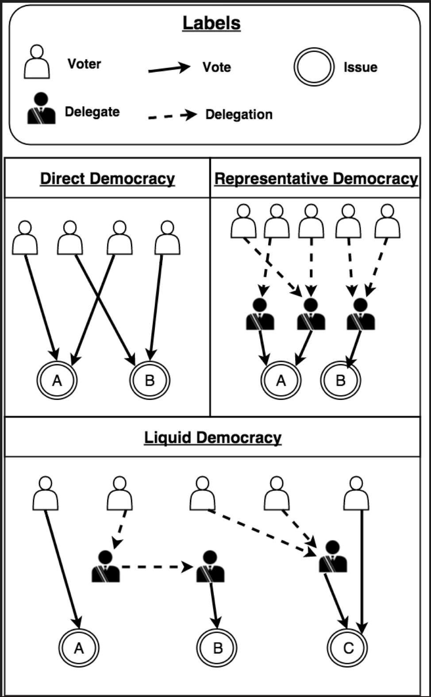
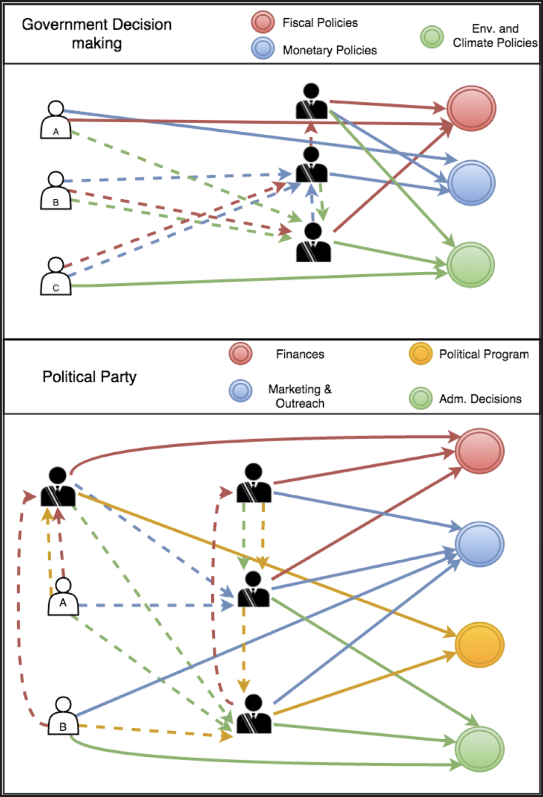

# Concept
Swiss DePa steht für Swiss Decentralized Party, zu deutsch Schweizer Dezentralisierte Partei. Primäres Ziel ist es eine DAO (Decentralized Autonome Organisation) aufzubauen, diese soll eine aktivere Teilnahme an der Politik ermöglichen. / Swiss DePa stands for Swiss Decentralized Party. The primary goal is to build a DAO (Decentralized Autonomous Organization), which should enable a more active participation in politics.
## Swiss DePa Jetzt
Swiss DePa befindet sich in der Aufbauphase. Discord dient als internes Kommunikations-Tool, die DAO auf Soonaverse ist das zukünftige Ideal.

### Landing Area
- Rules
- Automatisierte Moderation

### Working Groups
- **Festlegung des grundsätzlichen Prinzips**
  - Discord als internes Kommunikations-Tool
  - DAO als zukünftiges Ideal ([Soonaverse](https://soonaverse.com))
- **Identitätsfeststellung** (siehe Repo [Identity-Verification](https://github.com/Swiss-DePa/Identity-Verification))
- **Strukturierung**
  - Aufbauphase: Aufteilung des Leads in verschiedene Departments
  - Wie in Zukunft
  - Klare Regelungen zur Spaltung der DAO (siehe [Spaltung & Dachorganisation](#spaltung--dachorganisation))
  - Reputation-System (siehe [Anerkennungs-System](#anerkennungs-system))
- **PR** (siehe Repo [Puplic-Relation](https://github.com/Swiss-DePa/Puplic-Relation))
  - Grafik/Design (Zukunft)
  - Kommunikation nach Aussen
- **Community Building**

## Swiss DePa in Zukunft
### DAO
Mit der Fertigstellung der Aufbauphase soll Swiss DePa in eine Dezentralisierte Autonome Organisation auf [Soonaverse](https://soonaverse.com/space/0xfb239ac24ef62fcf7093a455c531ecd038cac412/overview) umgewandelt werden. Ziel bleibt eine aktivere Teilnahme an der Politik, die auch effektiv wirken kann. Durch die Struktur einer DAO soll eine Plattform geschaffen werden, die das Einbringen einer politischen Meinung vereinfacht und das Erarbeiten von konstruktiven Lösungsvorschlägen ermöglicht.

#### Vergleich DAO und Verein
Praktisch alle Parteien in der Schweiz sind Vereine. Eine DePa wäre anstelle eines Vereines ein DAO.
[Ein Verein besteht zwingend aus den Mitgliedern und aus dem Vorstand](https://de.wikipedia.org/wiki/Vereinsrecht_(Schweiz)) bei einem DAO ist dies nicht der Fall. Bei einem DAO bekommen verschiedene Mitglieder zwar schon Rollen, aber nicht einen Autoritären zustand. Entscheidungen werden generell immer mit einem Voting nach [liquiddemokratischem System](https://medium.com/organizer-sandbox/liquid-democracy-true-democracy-for-the-21st-century-7c66f5e53b6f) getätigt. Solche Votings werden durch "Proposals" getriggert 

#### Vergleich der DAO Swiss DePa mit einer Demonstration
Beide Organisationen haben das Potenzial, die Aufmerksamkeit für bestimmte Probleme zu erhöhen und Politiker unter Druck zu setzen. Unglücklicherweise werden Demonstrationen von verschieden Gruppierungen missbraucht und der ursprüngliche Grund zur Demonstration kann zum Beispiel in Krawallen untergehen. Ebenfalls ist es schwierig während der Demonstration konstruktive Lösungsvorschläge der Politik näherzubringen. Swiss DePa hat hingegen den Vorteil, als grosse Community Lösungsvorschläge schon weitgehend auszuarbeiten und mit gemeinsamen Konsens politischen Druck auszuüben. So werden den Politikern die Lösungen bereits auf dem Silbertablett serviert und durch die Unterstützung von Swiss DePa auch die Wichtigkeit des Anliegens untermauert.
### Funktionsweise von Swiss DePa
Entscheidungen werden nach liquiddemokratischem System getroffen. Die Grafik vergleicht die drei Modelle: In der direkten Demokratie stimmt jede Person selbst über jedes Anliegen ab, in der repräsentativen Demokratie delegieren alle ihre Stimme pauschal an Vertreter. In der Liquid Democracy kann jede Person pro Anliegen wählen, ob sie selbst abstimmt oder ihre Stimme an einen Delegierten überträgt; Delegierte können die Stimme ihrerseits weiter delegieren.

Die Delegation gilt nicht pauschal, sondern pro Themenbereich. Die zweite Grafik zeigt das am Beispiel staatlicher Entscheidungsfindung (Fiskal-, Geld-, Umwelt- und Klimapolitik) und einer politischen Partei (Finanzen, Marketing & Outreach, Politisches Programm, Administrative Entscheide): Dieselbe Person kann bei einem Thema selbst abstimmen und bei einem anderen an unterschiedliche Delegierte übertragen.

### Anerkennungs-System
Reputation-System:
- Visuelles Merkmal (Tag), siehe [Tag System](https://github.com/Swiss-DePa/Identity-Verification/blob/main/Tag%20System.md)
- Trial Phase, Vertrauen als Grundsatz
- Wahl in der Aufbauphase (Kollegialitätsprinzip, Begrenzung der Amtsdauer [Trial Phase])

### Spaltung & Dachorganisation
- Klare Regelungen zur Spaltung der DAO
- Übergeordnete DAO, ähnlich einem Dachverband bei Vereinen

Siehe auch: [Kategorien](Kategorien.md) · [Roadmap](Roadmap.md)
